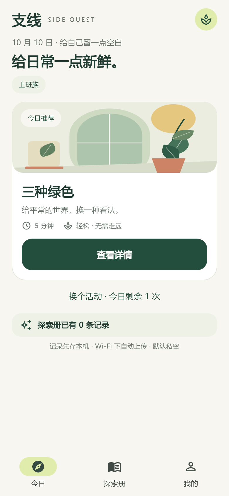
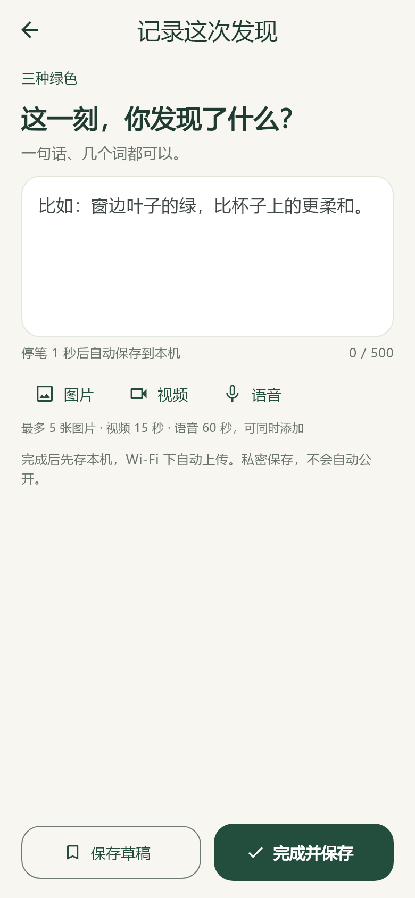
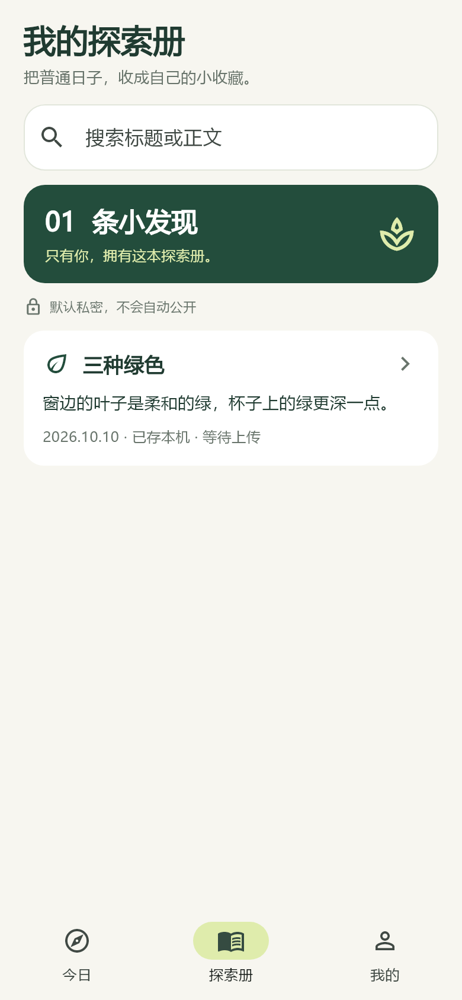

# 支线 · 0.2.0 联网记录版

[](https://github.com/W-CLL/sidequest-app/actions/workflows/checks.yml)

用 5–10 分钟观察身边、尝试一件小事，再把发现记进自己的探索册。Flutter Android 客户端 + Node.js 24 / SQLite 私有 API。本轮只做本地服务联调，**没有部署公网服务**。

仓库：[W-CLL/sidequest-app](https://github.com/W-CLL/sidequest-app)。`v0.1.0`、`v0.1.1` 保留文字版基线；当前客户端版本为 `0.2.0+3`。本轮变化见 [CHANGELOG.md](CHANGELOG.md)，协议见 [docs/v0.2-contract.md](docs/v0.2-contract.md)。

## 当前体验

- 8 类身份、6 项偏好（最多选 3 项），40 条活动；持续侧重偏好、最近 7 次推荐排重、历史保留 40 次。
- 正式账号必须连接同一个服务。账号、活动进度、正式记录存服务器 SQLite；令牌在手机安全存储中，手机不保存密码或密码散列。
- 记录文字为 1–500 个 Unicode 码点，可混合附加最多 5 张图片、1 段 15 秒视频、1 段 60 秒语音。相册选择图片/视频，应用内录音；不拍摄、不导入外部音频。
- 自动保存草稿，离线也能完成、继续下一项或暂停。正文、附件引用、上传队列先写入手机 SQLite，成功后才进入下一项。
- WiFi 自动上传；移动网络“立即上传”只授权当次待传批次。探索册区分本机待上传和服务器已确认记录。
- 同步使用持久任务锁、稳定 ID、回执和删除去重标记。冲突时保留离线记录，采用云端进度，冲突草稿单独处理。
- 探索册支持标题/正文搜索、云端每页 20 条、在线编辑/删除。图片分享卡默认不选择图片，不包含账号信息、视频、语音或媒体链接。
- 移除用户 JSON 导入/导出。运维备份是配套数据库与私有媒体目录，不是用户导出功能。

保留米白、森林绿与植物元素、紧凑布局和直接文案。长记录、附件列表、小屏、大字号及键盘展开时允许自然滚动，主要操作保持可到达。

## 开发与检查

需要 Flutter **3.47.0** / Dart **3.13.0**、Node **24**、FFmpeg 和 FFprobe；Android 构建使用 Java **21**。

```text
flutter pub get
node scripts/generate-catalog.mjs --check
flutter analyze
flutter test
node --test server/server.test.mjs server/media.test.mjs server/catalog.test.mjs
```

命令行的 `node` 从 `PATH` 获取；Flutter 真实 API 测试还支持用 `SIDEQUEST_NODE` 指定 Node 绝对路径。FFmpeg、FFprobe 可从 `PATH` 获取或通过 `FFMPEG_PATH`、`FFPROBE_PATH` 指定。测试使用独立临时数据库和媒体，不读取或清空真实账号数据。

客户端**必须配置 `API_BASE_URL`**；未配置时显示配置错误，不再退回本机账号。Android USB 本地联调用 `adb reverse tcp:8787 tcp:8787` 和 `http://127.0.0.1:8787`；远程服务必须 HTTPS。启动、APK、备份和实际验证记录见 [BUILDING.md](BUILDING.md)、[server/README.md](server/README.md)。

`Checks` 在 `main` 推送和 PR 时运行静态检查、Flutter/真实 API 合约、Node/真实媒体转换测试。Android 工作流保持手动触发，不自动发布 GitHub Release。

## 数据与使用边界

- 首次注册/登录、每日更换、账号设置、已保存记录修改/删除需要联网。重新登录同一账号后可以恢复保留的队列，其他账号不能接管。
- 手机待传队列上限 20 条、500 MiB；服务器每账号媒体默认 1 GiB，包含暂存和预留。限额不足时不自动删除内容。
- 服务端验证实际媒体内容，规范化图片和缩略图、视频 MP4/H.264/AAC、语音 M4A/AAC；媒体通过鉴权接口读取，令牌不放 URL。
- Android 后台上传由系统尽力调度，不能保证强制停止应用后继续上传。网络类型判断也不等于网络实际可达或绝对免费。
- 数据库和私有媒体目录不是端到端加密，也不代表数据永不丢失。卸载会丢失尚未同步的手机内容；运维需做配套备份与恢复演练。
- 不迁移旧本机账号或旧服务数据库，不自动清除旧文件。新版本使用独立数据库路径；旧服务数据库会被明确拒绝。
- 无公共广场、定位、广告、行为统计、密码找回或通知提醒。尚未完成生产合规、服务条款和隐私政策审查；请只使用测试账号和非敏感内容。

Android 实体设备、原生权限/相册/录音中断/后台调度需单独验收；APK 编译、Widget 模拟和桌面 API 测试不等于真机通过。iOS 需 macOS/Xcode 另行构建。本轮不把 Web/桌面作为可用的离线客户端交付。

## 界面预览

开发预览见 [screenshots/README.md](screenshots/README.md)，由 Flutter 渲染，**不是 Android 真机截图**。

| 今日 | 记录 | 探索册 |
| --- | --- | --- |
|  |  |  |

仓库公开，但未自动添加开源许可证；公开可见不代表已选择具体授权条款。
