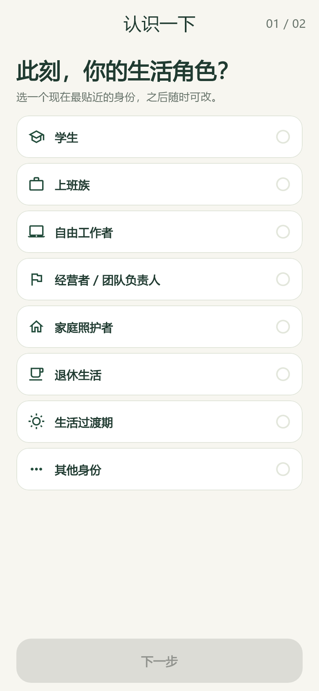

# 支线 · 0.1.1 文字体验版

[](https://github.com/W-CLL/sidequest-app/actions/workflows/checks.yml)

用 5–10 分钟观察身边、尝试一件小事，再把发现记进自己的探索册。Flutter 客户端优先交付 Android 调试包，另有可选的 Node.js 24 / SQLite 后端。

公开仓库：[W-CLL/sidequest-app](https://github.com/W-CLL/sidequest-app)。`main` 是交付分支；`v0.1.0` 保存初版基线，`v0.1.1` 对应本轮界面与文案优化。更新见 [CHANGELOG.md](CHANGELOG.md)。

## 当前体验

- 8 类生活身份；6 项探索偏好，最多 3 项，可跳过及修改。
- 浏览推荐无需登录；开始时使用昵称和密码创建账号或登录，不收集手机号。
- 16 条固定目录活动，约 5–10 分钟，提供具体步骤和安全提示。
- 每天可更换活动一次；“先放一放”保留草稿；完成后可主动选择“继续探索”。
- 最多 300 个 Unicode 码点的文字记录、手动保存草稿、返回时尝试保存、私密探索册与单条删除。
- 确认后生成图片分享卡，不包含账号昵称、身份和偏好。支持 JSON 导出和验证密码后删除账号。
- 默认本机保存，也可在构建时配置远程 API，两种模式共用同一业务接口。

## 本轮调整

保留“支线”的名称及米白、森林绿视觉。身份选择改为紧凑列表，偏好使用响应式双列布局；首页插画、卡片和说明减少占高。详情、记录及账号页面提供固定主操作，小屏、大字号和键盘展开时仍可滚动访问全部内容。

界面使用“查看详情、开始、继续记录、换个活动、先放一放、继续探索、完成并保存”。未开放的媒体入口移出记录流程，相关限制统一放在“我的 → 版本说明”。没有新增业务功能或更改数据格式。

## 开发与检查

使用 Flutter **3.47.0** / Dart **3.13.0**、Node **24**；Android 构建使用 Java **21**。

```text
flutter pub get
flutter analyze
flutter test
node --test server/server.test.mjs
flutter build apk --debug --split-per-abi
```

真实客户端合约测试会启动临时 Node API 和 SQLite 数据库。Node 24 需位于 `PATH`，或通过 `SIDEQUEST_NODE` 指定可执行文件。测试不会连接公网服务或读取真实账号数据库。

- `Checks` 在 `main` 推送与 PR 时执行静态检查、Flutter 测试和 Node 集成测试。
- `Android alpha APK` 继续手动触发，生成三架构 debug APK 与 SHA-256 校验文件，不自动发布 Release。
- 构建、安装、截图再生成和本轮验证记录见 [BUILDING.md](BUILDING.md)。

2026-10-10 本机验证：静态检查通过；Flutter 32 项、Node 10 项测试通过；截图生成单独通过。三个架构的 Android debug APK 已构建并核验签名，APK、日志和校验文件保存在未跟踪的 `artifacts/v0.1.1/`。尚未连接实体手机验收。

## 布局验收与预览

布局测试覆盖 390×844 常规屏、360×640 与 320×568 小屏、1.3/2.0 倍字号、约 300dp 键盘，以及推荐/进行中/完成等状态。长记录、说明页面及必要的小屏内容允许滚动。

`screenshots/` 是由 Flutter 渲染并使用本机中文字体生成的开发预览，**不是 Android 真机截图**。字体文件不会写入仓库或打包进应用。

| 身份 | 今日 | 记录 |
| --- | --- | --- |
|  |  |  |

更多预览见 [screenshots/README.md](screenshots/README.md)。

## 当前边界

默认 APK 没有配置公网 API。账号和记录只保存在当前安装中，昵称不代表跨设备唯一；卸载或清除应用数据会丢失资料。本机密码采用随机盐 PBKDF2，记录正文没有额外加密，请使用测试密码及非敏感记录。

后端源码与真实客户端合约已经实现，但没有部署到公网。接入远程服务需部署 HTTPS API 并重新构建客户端，详见 [server/README.md](server/README.md)。本机记录暂不能迁移到云端。

探索偏好可以保存，部分活动有身份场景提示；当前按固定目录顺序推荐，没有按偏好排序或 AI 推荐。媒体、通知、密码找回、离线冲突合并和实时同步均未实现。

没有公共广场、定位、广告或行为统计。尚未完成正式适龄政策、公开服务条款、隐私政策和生产合规审查；本版本用于小范围产品验证。Android 真机交互和 iOS 构建仍需单独验收。
